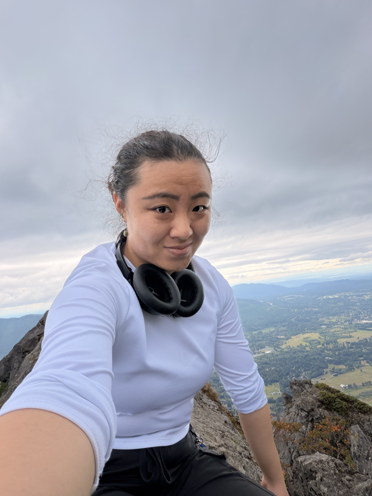

# About Me

Hello! My name is **ShengYao**. I study *Computer Science* at the University of Washington. This page describes my academic interests and experience.

## Academics

I am currently taking **ENGL 396: Software Documentation**, **CSE447 Natural Language Processing**, and **CSE475 Embedded Systems Capstone**. After I graduate, I hope to work as a *Software Engineer* or in a related field.

Here is a list of my favorite classes:

- [CSE 474 Intro to Embedded Systems](https://courses.cs.washington.edu/courses/cse474/)
- [CSE 447 Natural Language Processing](https://courses.cs.washington.edu/courses/cse447/)
- [CSE 311 Foundations of Computing I](https://courses.cs.washington.edu/courses/cse311/)

## Experience

The following table summarizes my experience with some tools that will be used in this class:

| Tool     | Experience       |
|----------|------------------|
| GitHub   | Experienced      |
| Markdown | Experienced      |
| HTML     | Experienced      |

## Learn More

Want to know more about me outside of school? Read my [About page](about.html).

You can also visit the [University of Washington website](https://www.washington.edu).
